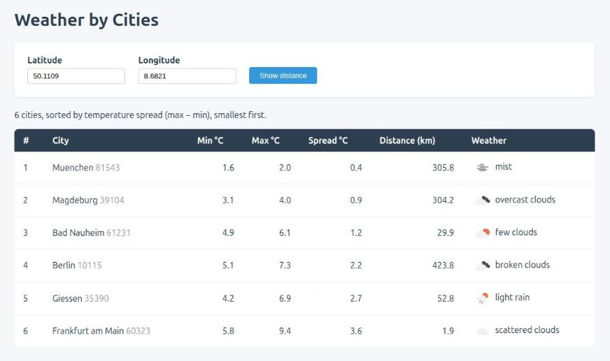

# Weather Cities

[](https://github.com/okarabudka/weather-cities/actions/workflows/ci.yml)

A small web application in plain PHP, without a framework. It reads a list of cities from `data/cities.dat`, fetches
the current weather for each one from OpenWeatherMap and shows them in a table sorted by temperature spread
(max − min, smallest first). Enter a latitude and longitude, and the table also shows the distance from that point to
every city in kilometres.



*Sample data: the screenshot was rendered through the real controller and templates with the fake weather client
used in the tests (`php bin/render-sample.php 50.1109 8.6821`), not with live OpenWeatherMap values.*

## Why it exists

It started as a take-home style task: no framework allowed, the weather provider must be easy to swap. That makes it a
good place to show the structure a framework usually hides: ports and adapters, a caching decorator, value objects,
the PSR interfaces, strict types and tests that never touch the network.

## What you get

**The page.** One form (latitude, longitude) and one table: city, min/max temperature, spread, distance and the
weather description with its icon. Invalid input (`lat=91`, `lon=abc`) is answered with an error message and HTTP 422.
If weather for one city cannot be fetched, that city stays in the table as "no data" at the bottom and the reason
goes to the PHP error log; it is never dropped silently. Without an API key the page answers with HTTP 503 and says
what is missing; a key that OpenWeatherMap rejects (HTTP 401) also gives a 503 with one message instead of the table.

**Architecture without a framework.**

```
public/index.php                 composition root: reads env, wires everything by hand
  └── Router                     method + exact path, 404 / 405
        └── WeatherController    validates lat/lon, builds the rows
              ├── CityFileParser             data/cities.dat → City[]
              ├── WeatherProvider (port)
              │     └── CachedWeatherProvider        decorator, PSR-16
              │           ├── FilesystemCache        PSR-16, one file per key
              │           └── OpenWeatherMapProvider adapter, PSR-18 + PSR-17 (Guzzle)
              ├── DistanceCalculator         haversine, km
              ├── CityWeatherSorter          by spread, stable
              └── TemplateRenderer           plain PHP templates, escaped output
```

- `WeatherProvider` is the only thing the controller knows about weather. Another provider is one new class and one
  changed line in `public/index.php`.
- `CachedWeatherProvider` adds caching to any provider. Coordinates are rounded to two decimals for the cache key;
  failures are not cached.
- The OpenWeatherMap adapter depends on the PSR-18 and PSR-17 interfaces, not on Guzzle. Tests pass a fake client.
- `Coordinates`, `City` and `WeatherData` are readonly value objects; `Coordinates` rejects values out of range.
- The API key travels in the OpenWeatherMap query string, so the adapter never puts the URL or the key into exception
  messages. A test checks this.

**Quality checks.** PHPUnit (unit tests plus a functional test of the full object graph on the real `cities.dat`,
with JSON fixtures instead of the network), PHPStan at level max with strict rules (tests included), PHP lint, and a
gitleaks secret scan in GitHub Actions.

Composer is used for libraries only: the PSR interfaces and Guzzle. `composer show` lists two `symfony/*` packages;
they are small helpers Guzzle depends on (`deprecation-contracts`, `polyfill-php80`), not the framework.

## How to use it

Requirements: Docker with Docker Compose and make. PHP is not needed on the host.

```bash
git clone https://github.com/okarabudka/weather-cities.git && cd weather-cities
make up                # creates .env from .env.example, builds and starts the containers, runs composer install
```

Open http://localhost:8080. Without a key it answers 503. Get a free key at
https://home.openweathermap.org/api_keys (a new key can take a few minutes to become active), put it into `.env`:

```dotenv
OWM_API_KEY=your_key
```

and run `make up` again. `.env` is git-ignored; never commit a key.

If port 8080 is taken, set `HTTP_PORT` in `.env` (for example `HTTP_PORT=8088`) and run `make up` again.

| Variable      | Default           | Meaning                                                |
|---------------|-------------------|--------------------------------------------------------|
| `OWM_API_KEY` | —                 | OpenWeatherMap API key, required                       |
| `CACHE_TTL`   | `600`             | Seconds a weather response is cached                   |
| `CACHE_DIR`   | `var/cache`       | Cache directory, relative to the project root          |
| `CITIES_FILE` | `data/cities.dat` | Input file, relative to the project root               |
| `HTTP_PORT`   | `8080`            | Host port of nginx                                     |

### Day-to-day work

| Target         | What it does                                       |
|----------------|----------------------------------------------------|
| `make up`      | Create `.env`, build and start containers, install |
| `make down`    | Stop and remove containers                         |
| `make install` | `composer install` in the container                |
| `make sh`      | Open a shell in the PHP container                  |
| `make test`    | Run PHPUnit                                        |
| `make stan`    | Run PHPStan (level max)                            |
| `make lint`    | Check PHP syntax                                   |
| `make check`   | `lint`, `stan` and `test`                          |
| `make help`    | List all targets                                   |

The tests need neither a key nor the network.

## The cities file

`data/cities.dat` has a header line, then one city per line, separated by spaces; names with spaces are
double-quoted. **Longitude comes before latitude.** Blank lines and lines starting with `#` are ignored. A header other
than the one below, or a broken line, stops the parser with its line number.

```
country zip city longitude latitude
DE 10115 Berlin 13.4251364 52.5075419
DE 60323 "Frankfurt am Main" 8.6650844666632700 50.1241893600359000
```

## Limitations

- The data comes from the current weather endpoint (`/data/2.5/weather`). Its `temp_min` and `temp_max` are not the
  daily minimum and maximum: they describe how much the temperature varies across the city area right now. The spread
  is therefore often 0–2 °C, and the sort order can look flat. A daily spread would need the forecast endpoint.
- The free OpenWeatherMap plan allows 60 requests per minute. Six cities are far below that, and the cache (10 minutes
  by default) serves repeated page loads without new requests.
- Cities are fetched one after another; there are no parallel requests.

## Status

Complete.

## License

MIT, see [LICENSE](LICENSE).
